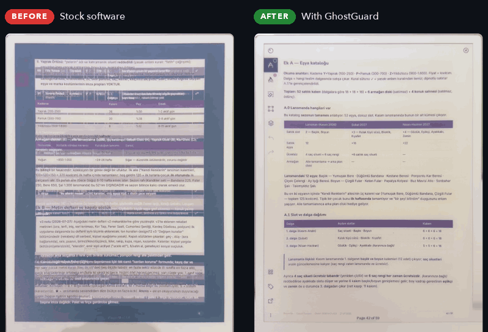

# reMarkable Paper Pro ghosting fix (GhostGuard)

**GhostGuard is a free, open-source ghosting fix for the reMarkable Paper Pro.** It changes how the tablet
refreshes its colour e-ink screen when you turn a page, so that the new page arrives clean instead of carrying a
faint copy of the page before it.

[](#tested-on)
[](#before-you-install)
[](docs/HOW-IT-WORKS.md)
[](LICENSE)

<p align="center">
  
</p>
<p align="center"><sub>The same tablet, minutes apart, turning the pages of a colour PDF.
<b>Left:</b> stock software 3.29.1 (GhostGuard had not started yet after a restart).
<b>Right:</b> GhostGuard running: one short full refresh per page turn, then a clean page.</sub></p>

**[Install](#install)** · [What it fixes](#what-it-fixes) · [FAQ](#faq) · [How it works](#how-it-works) ·
[Risks](#risks) · [Uninstall](#uninstall)

## What it fixes

If your Paper Pro does any of this, GhostGuard is made for it:

- **Ghosting after a page turn.** A faint copy of the previous page (a ghost image, an afterimage) stays visible
  behind the new one, and it piles up from page to page.
- **A patchy background on colour documents.** The white of the page comes out yellowish or lilac in places.
- **Residue after leaving a screen.** Closing a document, opening Settings or closing the on-screen keyboard
  leaves traces of what was there before.
- **No quick way to clean the screen.** GhostGuard adds a **refresh button** to the document toolbar: one tap
  redraws the whole screen.

It is free, open source (MIT), and one command removes it again.

## Before you install

- It works on **exactly one software version**: reMarkable Paper Pro, software **3.29.1** (build `20261028104944`).
  On any other version the installer refuses and the add-on stays passive. A tablet that updates itself goes back
  to stock behaviour until this project is updated.
- It was developed and tested on **one tablet**, judged by **one person's eyes**, installed from **one Mac**.
  Your panel may behave differently.
- It needs **developer mode**. Turning developer mode on **erases the tablet** (factory reset; your notes come back
  from the cloud if you sync first), shows a warning at every start, and reMarkable says damage caused in
  developer mode is not covered by the warranty.
- It is not made or endorsed by reMarkable AS. You use it at your own risk. See [Risks](#risks).

## Install

| You need | Details |
|---|---|
| Tablet | reMarkable Paper Pro (the 11.8" colour model; not the Paper Pro Move, not a reMarkable 2) |
| Software | exactly **3.29.1**; look at *Settings → General → Software* |
| Developer mode | on (step 1; skip it if you already have it) |
| Computer | macOS or Linux; on Windows use WSL |
| Cable | the tablet's USB-C cable |
| Time | about 30 minutes, most of it waiting |

No programming needed: you paste one command and answer the installer's questions.

1. **Sync your tablet**, then turn on developer mode:
   *Settings → General → Paper Tablet → Software → Advanced → Developer mode*. The tablet erases itself and restarts.
2. **Note the password** shown at *Settings → General → Help → About → Copyrights and licenses → General information*.
3. **Connect the tablet** to the computer with the USB cable. Keep it awake and unlocked.
4. **Download GhostGuard and run the installer.** Open a terminal and paste:

   ```bash
   git clone https://github.com/TapForge/remarkable-paper-pro-ghosting-fix.git \
     && cd remarkable-paper-pro-ghosting-fix \
     && bash install.sh
   ```

   The installer explains each of its six parts and asks `[y/N]` before it changes anything. It asks for the
   password from step 2 once. No `git`?
   [Download the ZIP](https://github.com/TapForge/remarkable-paper-pro-ghosting-fix/archive/refs/heads/main.zip),
   unpack it, open a terminal in that folder and run `bash install.sh`.
5. **Let it restart the tablet**, then leave the tablet awake and untouched for about four minutes. The screen
   restarts once by itself; after that GhostGuard is running.
6. **Check it:**

   ```bash
   bash status.sh
   ```

   The last line should say `RESULT: GhostGuard is running.`

Every screen and every question of the installer is described in **[docs/INSTALL.md](docs/INSTALL.md)**. If a
step stops, **[docs/TROUBLESHOOTING.md](docs/TROUBLESHOOTING.md)** has the fix.

The installer adds the four [start-up extras](#start-up-extras) by default; `GG_EXTRAS=none bash install.sh`
installs none.

## Uninstall

Connect the tablet, keep it awake, and in the project folder run:

```bash
bash uninstall.sh --now
```

The screen restarts once and the tablet is back to its stock behaviour, also after every later restart.

## How do I know it works?

Open a PDF with colour (a textbook, a magazine) and turn a few pages. Each turn away from a colour page is now one
short full refresh, and the page behind it should be gone. With the default extras a black-and-white page turns the
same way; without the `bwturn` extra it stays flash-free. The document toolbar also gets a refresh button (see
[Start-up extras](#start-up-extras)). `bash status.sh` on the computer prints `RESULT: GhostGuard is running.`

## What changes, screen by screen

| Situation | Stock software | With GhostGuard |
|---|---|---|
| Page turn on a colour page | fast partial update, the old page shows through | **one** full refresh (about 1 s), corrected so that the old text does not stay behind |
| Page turn on a black-and-white page | fast partial update, a faint trace | with the start-up extra `bwturn` (installed by default): the turn of a colour page, **one** full refresh with no visible trace. Without it: no flash, and a trace reduced by a compensating drive |
| Closing a document | a flash that leaves residue | one full refresh at the moment of the change, with the white tail; no ghost phase, no late flash (extra `viewchange`). Without it: the new view first, one clean in-place refresh 0.6-0.9 s later |
| Opening and closing Settings | a flash that leaves residue | one clean in-place refresh about half a second after the change, on the finished view (extra `settingskb`) |
| On-screen keyboard | closing: a flash that leaves residue | opening: one clean in-place refresh about 0.5 s later, before the first key (extra `settingskb`); closing: one clean refresh after the screen has settled |
| Menus, pop-ups, typing, handwriting | – | unchanged, no added flash |

## FAQ

### Does it work on the reMarkable Paper Pro Move, the reMarkable 2 or the reMarkable 1?

No. GhostGuard is made for the reMarkable Paper Pro (11.8") only. The installer checks the tablet's software and
refuses anything else.

### Which software version do I need?

Exactly **3.29.1** (build `20261028104944`). GhostGuard reads private data structures of the tablet's main
program, and their positions change with every version, so it is pinned to one build.
[docs/BUILDING.md](docs/BUILDING.md) lists what a port to another version has to change.

### What happens when the tablet updates its software?

GhostGuard notices at the next start that the version is not the tested one and does not start; the tablet simply
behaves like stock. To keep GhostGuard, turn off automatic updates (*Settings → General → Software*) and check
this page for a newer build before you update.

### Do I need developer mode, and does it erase my tablet?

Yes to both. GhostGuard is installed over SSH, which only developer mode offers. Turning developer mode on is a
factory reset: notes and documents that are synced to your reMarkable account come back afterwards, anything that
is not synced is lost.

### Does every page turn flash now?

A page turn becomes one full refresh of about a second; that refresh is what clears the old page. Menus, pop-ups,
typing and handwriting get no added flash. Black-and-white pages can stay flash-free (install without the
`bwturn` extra), and [docs/SETTINGS.md](docs/SETTINGS.md) has a flash-free mode for colour pages too, at the price
of a patchy background.

### Can it damage my tablet?

We have seen no damage on our tablet, and GhostGuard is built to fail safe: before every start it checks the
firmware and its own files, it falls back to the stock software if anything fails, and it switches itself off
after two bad starts. SSH over USB stays available, so it can always be removed. Still, it was tested on one
tablet, it adds drive to the panel on every full refresh, and the long-term effect on the panel has not been
measured. Please read [Risks](#risks) before you decide.

### Does it change the tablet for good?

No. The waveform change lives in the running program's memory only: nothing on disk and nothing in the display's
own storage is modified, and a restart brings the original back. `bash uninstall.sh --now` switches GhostGuard
off for good; [docs/TROUBLESHOOTING.md](docs/TROUBLESHOOTING.md#removing-every-trace) shows how to delete its
files as well. Developer mode itself stays on until you leave it with reMarkable's recovery tool.

### Why does the reMarkable Paper Pro ghost at all?

Mostly because of how its colour panel is driven during a page turn: pixels that the software leaves alone are
still pushed by the rest of the screen, and old text that turns white keeps a faint dark trace. The short version
is in [How it works](#how-it-works), the measurements are in [docs/HOW-IT-WORKS.md](docs/HOW-IT-WORKS.md).

### Can I install it from Windows?

Through WSL (the Ubuntu app), following the same guide. We have not tested that route ourselves.

### Is this an official reMarkable fix?

No. It is a community project, not made or endorsed by reMarkable AS.

## How it works

### What causes the ghosting

Short version of what we measured ([docs/HOW-IT-WORKS.md](docs/HOW-IT-WORKS.md) has the details and the numbers):

1. **The panel's shared electrode follows the average drive of the whole screen.** Pixels that the software "holds"
   during an update are not really at rest; they get pushed by whatever the rest of the screen is doing, and white
   areas come out tinted.
2. **The panel has two different "whites"** (plain page white, and the white inside shaded or dithered areas).
   On a designed colour PDF about a quarter of all pixels flip between the two at every page turn. They are white
   before and after, yet they get the full, strong white waveform, and that is about 75 % of the disturbance in 1.
3. **A full refresh that changes the content does not erase the old content.** Pixels going from old text to white
   keep a faint dark trace. Only a refresh of a picture that is already on the screen cleans completely.

### What GhostGuard does about it

- **Colour pages:** the turn is sent as one full refresh, and the tablet's waveform table (in memory only) gets a
  short "white tail": seven otherwise idle frames at −12 V on the 43 ink-to-white transitions. That pushes the
  leftover of the old text to white inside the same refresh, so no second pass is needed.
- **Black-and-white pages:** with the `bwturn` extra they turn like colour pages (one full refresh with the white
  tail). Without it the turn stays flash-free: held pixels get a small compensating voltage, and the
  white-to-white flips are parked at 0 V for the length of the turn.
- **View changes:** with the `viewchange` extra xochitl's own full refresh stays at the moment of the change.
  Without it the stock flash is withdrawn and one clean in-place refresh follows when the screen is still.
  For Settings (opening and closing) and for the keyboard opening, the `settingskb` extra brings back the
  deferred cycle: one whole-screen in-place clean once the new view is finished.

The engine is ggsense 1.8.32. Four small start-up extras switch these behaviours on; see
[Start-up extras](#start-up-extras).

We tried about twenty other approaches first: cleaning after every page, cleaning every N pages, flash-free
compensation for colour pages, two refreshes per turn, a white screen in between, and more. Each one is listed in
**[docs/WHAT-WE-TRIED.md](docs/WHAT-WE-TRIED.md)** with the reason it was dropped.

## Start-up extras

A start-up extra is a small JavaScript file `tools/<name>.js` that GhostGuard sends to the tablet's interface after
every start of `xochitl`, as the last step of `deploy/boot/ggapply.sh`, after the clock and its status check, in a
fixed order. `install.sh` installs all four by default. The start's result line names them, for example
`ACTIVE: ggsense 1.8.32 in xochitl 1554, defer 1, triggers on; keyboard watcher on; splash cleaned; extras: bwturn on, ggrefresh on, viewchange on, settingskb on`.
An extra that is not confirmed does not stop GhostGuard; the line then says `<name> not confirmed`.

| Extra | What it does | Undo now (until the next restart) |
|---|---|---|
| `bwturn` | Black-and-white and grey pages turn like colour pages: one full refresh with the white tail. A blank page still turns without a flash. | `bash settings.sh tf_chroma 25` |
| `ggrefresh` | A refresh button in the document toolbar, right below undo/redo. A tap is one full in-place refresh of the screen (at most one every 2.5 s, not while the tablet sleeps). It moves and hides with the toolbar. It is made again after every start of `xochitl`, so it appears only once GhostGuard has started (a few minutes after a boot). | `python3 -I tools/ggq.py tools/ggrefresh.js --sub GGRCMD=kill` |
| `viewchange` | Sets `defer 0`: at a view change xochitl's own full refresh stays, so the new view's first frame is one full refresh. | `bash settings.sh defer 1` |
| `settingskb` | One clean in-place refresh about half a second after Settings opens or closes, and after the on-screen keyboard opens (needs ggsense 1.8.31 or later). | `bash settings.sh vs_open 0` and `bash settings.sh kb_open_full 0` |

Settings sent by extras live in the engine's memory only and are sent again at every start. To change one for good,
install again with another set:

```bash
GG_EXTRAS="bwturn ggrefresh" bash install.sh
```

installs only the named extras (always in the fixed order), and `GG_EXTRAS=none bash install.sh` installs none. Then
restart the tablet. With no extras the behaviour is that of ggsense 1.8.30: black-and-white pages flash-free, and
view changes "new view first, one in-place clean 0.6-0.9 s later". Details: [docs/INSTALL.md](docs/INSTALL.md) and
[docs/SETTINGS.md](docs/SETTINGS.md).

## Risks

Please read these before you install.

- **Developer mode.** Factory reset when you turn it on; SSH access to the tablet with a root password; warranty
  and security consequences as described by reMarkable. Leaving developer mode needs reMarkable's recovery tool.
- **One firmware only.** GhostGuard reads private data structures of the tablet's main program (`xochitl`). It
  checks the exact build before doing anything and stays passive on any other. After a software update it switches
  itself off; turn off automatic updates if you want to keep it.
- **It changes waveform data in memory.** The white tail is written into the running program's copy of one
  waveform table (the one for 22–28 °C). Nothing on disk and nothing in the display's own storage is modified, and a
  restart brings the original back. But the tail adds drive to the panel on every full refresh, and **we have not
  measured the long-term effect** on the panel (image retention, DC balance) over weeks or months.
- **Above 28 °C panel temperature** the tablet uses another table; there GhostGuard's colour page turn is a plain
  full refresh and a faint trace can remain.
- **Automatic start.** XOVI, the loader GhostGuard uses, is by design *not* started at boot, and its authors warn
  against starting it automatically, because a broken extension could then keep the tablet from starting its
  interface. GhostGuard does start it automatically, about three minutes after boot, behind these guards: it checks
  the firmware and every file first, waits until the tablet has been untouched for two minutes, watches the
  interface afterwards, falls back to the stock software if anything fails, and disables itself after two bad
  starts. These guards worked on our tablet. They are still our own code, tested on one device.
- **SSH always stays available** over USB in developer mode, so the add-on can be removed even if the interface
  does not come up: `bash uninstall.sh --now`.
- **The installer's first-time path is new.** Setting up the SSH key and installing XOVI on a fresh tablet was
  written for this release and has not been run on a second device yet. The GhostGuard step itself is the one we
  used many times. If something goes wrong, [docs/TROUBLESHOOTING.md](docs/TROUBLESHOOTING.md) has the way back.

## Everyday commands

Run these on the computer, in the project folder, with the tablet connected by USB and awake.

| Command | What it does |
|---|---|
| `bash status.sh` | Is GhostGuard running? |
| `bash status.sh log` | Its start-up log |
| `bash settings.sh KEY VALUE` | Change a setting until the next restart ([docs/SETTINGS.md](docs/SETTINGS.md)) |
| `git pull`, then `bash install.sh` | Update to the newest version of this project (then let it restart the tablet) |
| `bash uninstall.sh` | Remove it (effective after the next restart) |
| `bash uninstall.sh --now` | Remove it and switch back to stock at once |

## Documentation

| Document | For whom |
|---|---|
| [docs/INSTALL.md](docs/INSTALL.md) | Everyone: step-by-step installation, including developer mode |
| [docs/TROUBLESHOOTING.md](docs/TROUBLESHOOTING.md) | When something does not work; how to switch it off or remove it |
| [docs/SETTINGS.md](docs/SETTINGS.md) | Choosing another page-turn behaviour |
| [docs/HOW-IT-WORKS.md](docs/HOW-IT-WORKS.md) | The root cause, the measurements, the waveform table format |
| [docs/WHAT-WE-TRIED.md](docs/WHAT-WE-TRIED.md) | Every approach we tried and why it was not chosen |
| [docs/BUILDING.md](docs/BUILDING.md) | Building from source, porting to another firmware |

## What is in this repository

```
install.sh, uninstall.sh, status.sh, settings.sh   the four commands for users
prebuilt/ggsense.so     the engine, built from ggsense/ggsense-1.8.32.c (aarch64)
ggsense/                engine source, unit tests, fuzz test, build script
ghostguard/             the small QML part that runs inside the tablet's interface
deploy/                 the boot-time installer, guards, rescue and rollback scripts
tools/                  helper programs (input watcher, table tool, command sender) and the start-up extras:
                        bwturn.js, ggrefresh.js, viewchange.js, settingskb.js (plus the clock and keyboard watcher)
docs/                   the documents above; docs/media/ holds the pictures of this page
```

No reMarkable software, waveform file or other proprietary data is included.

## Tested on

| | |
|---|---|
| Tablet | reMarkable Paper Pro (11.8", Gallery 3 colour panel, 1620 × 2160) |
| Software | 3.29.1, build `20261028104944` |
| Loader | XOVI with qt-resource-rebuilder, release `v19-23052026` of [asivery/rm-xovi-extensions](https://github.com/asivery/rm-xovi-extensions) |
| Computer | macOS (the scripts are plain bash and should run on Linux and WSL; not tested there) |
| Panel temperature | 25–27.5 °C |

The Paper Pro Move and the reMarkable 1 and 2 are **not** supported.

## Helping

- If it works or does not work on your tablet, please open an issue and say which software version you have,
  what kind of document you read, and what you see. Reports from a second device are worth a lot.
- If you port it to another software version, [docs/BUILDING.md](docs/BUILDING.md) lists what is version-specific.
- If it cleaned up your screen, a star helps other Paper Pro owners find it.

## Credits and licence

- GhostGuard is released under the [MIT licence](LICENSE).
- It relies on [XOVI](https://github.com/asivery/xovi) and
  [rm-xovi-extensions](https://github.com/asivery/rm-xovi-extensions) by asivery, which are separate projects with
  their own licences; the installer downloads them from their official release page and does not redistribute them.
- reMarkable is a trademark of reMarkable AS. This project is not affiliated with reMarkable AS.
- The engine was developed with the help of Claude (Anthropic) in a long measure-and-try loop on the owner's
  tablet; the owner's eyes made every final decision.
